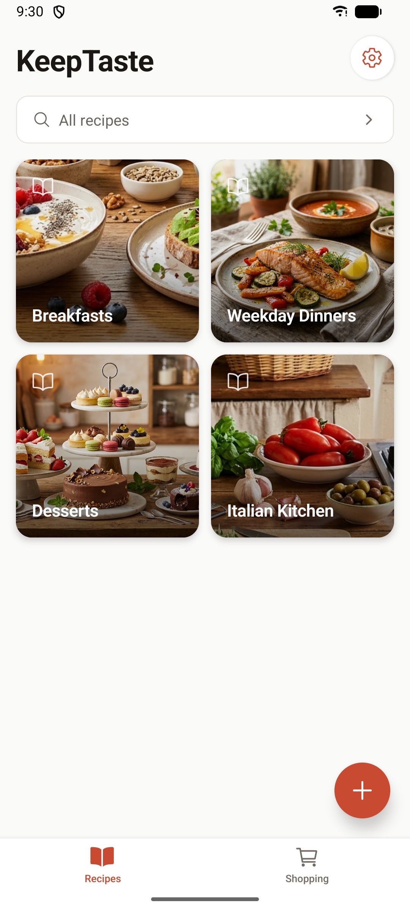
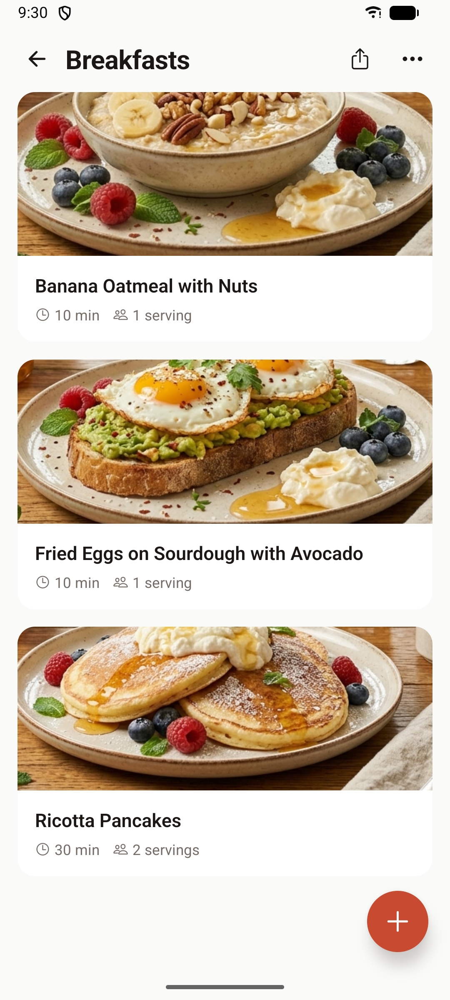
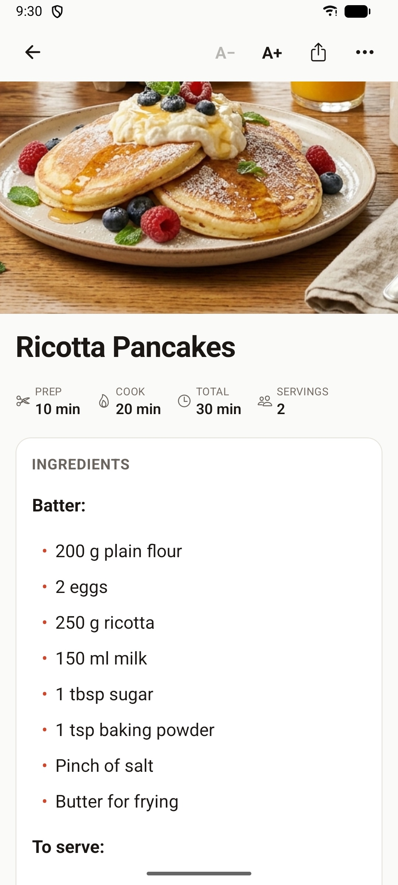
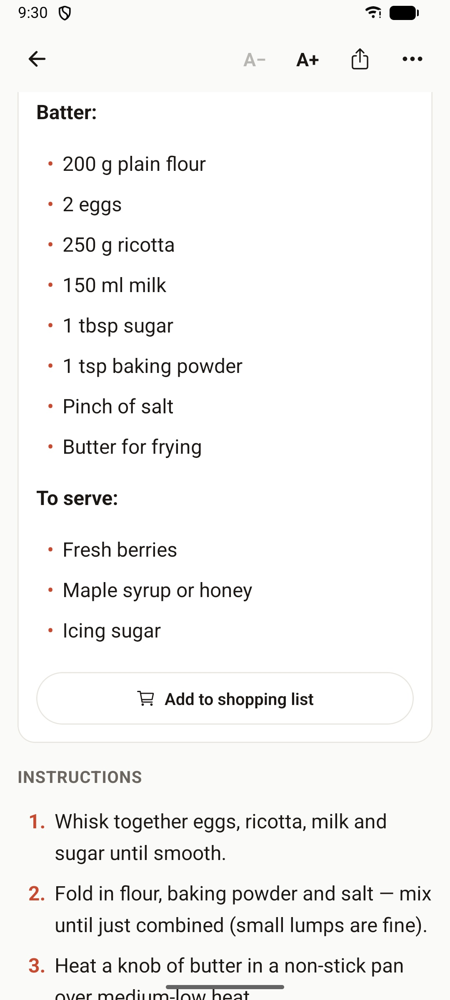
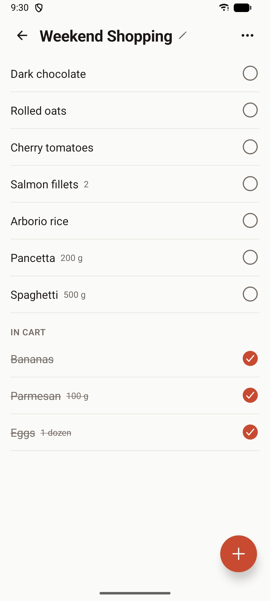
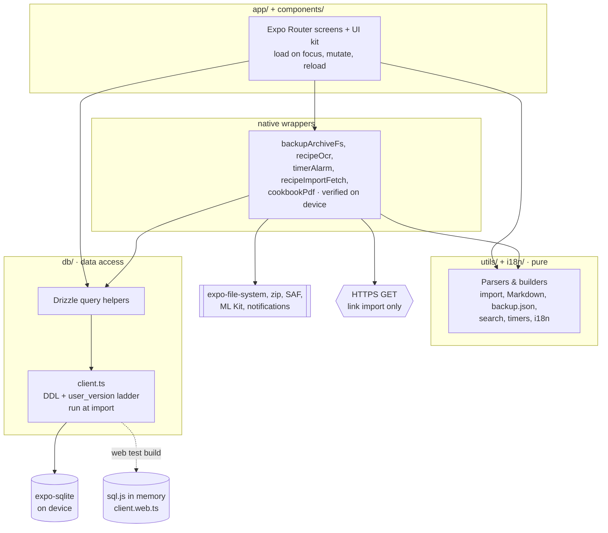

# KeepTaste

[](https://github.com/Maleckidd/KeepTaste/actions/workflows/ci.yml)
[](https://github.com/Maleckidd/KeepTaste/actions/workflows/security.yml)
[](https://github.com/Maleckidd/KeepTaste/actions/workflows/codeql.yml)


[](LICENSE)

> **Your recipes. Your device. No cloud required.**

> **Project status:** feature-complete and live on Google Play. This is a
> personal project published as a portfolio case study in **quality,
> security and controlled AI-assisted development**: see
> [how it is tested](docs/TESTING.md), [its threat model](SECURITY.md) and
> [how it was built with AI](docs/AI-WORKFLOW.md). It is not actively
> developed, and contributions are not accepted ([CONTRIBUTING.md](CONTRIBUTING.md)).

---

## Available on Google Play

[Install KeepTaste from Google Play](https://play.google.com/store/apps/details?id=com.damianmalecki.keeptaste)

---

KeepTaste is a private, offline-first recipe manager for Android. Every recipe,
photo, and shopping list lives in a local database on your phone — there are no
accounts to create, no servers to trust, no subscription, and no ads. Ever.

**Philosophy: your data, your device.** You are never locked in: the whole
library exports to plain, human-readable Markdown, and a complete `.zip` backup
(photos and all) can be restored 1:1 — or mirrored automatically to a
cloud-synced folder *you* control.

<p align="center">
  
  
  
  
  
</p>

<p align="center"><em>Your cookbooks → a cookbook → a recipe → one tap to a shopping list → shopping with the "in cart" flow.</em></p>

## Why KeepTaste?

- **Works offline.** On a plane, in a basement kitchen, on a phone with no
  SIM. The only thing that needs a connection is importing a recipe from a
  link: the phone fetches that page directly from the recipe site.
- **Private by design.** No account, no analytics, no tracking, and no
  KeepTaste server. Your library stays on the phone unless you export, share
  or back it up yourself. (One known exception, a fix for which is
  proposed: an image link written into a recipe's Markdown is loaded when
  the recipe is shown. See [SECURITY.md](SECURITY.md#threat-model).)
- **No lock-in, guaranteed.** One tap exports everything to Markdown you can
  read in any text editor — and import back later.
- **Fast and focused.** Built for the two moments that matter: saving a recipe
  in seconds, and cooking from it with the screen kept awake.

## Features

### 🍳 Collect & organize
- **Cookbooks with covers** — group recipes the way you think about them.
- **Recipes in Markdown** — ingredients, instructions, and notes with real
  formatting; prep/cook times, servings, and a photo.
- **Import a recipe** — paste a link and KeepTaste extracts it (Schema.org
  JSON-LD), paste plain text, or **snap a photo** of a page and on-device OCR
  reads it into the form — all parsed on your phone, no server.
- **To-try list** — mark a recipe "to try"; it sinks to a "To try" section and a
  filter chip answers "what should I cook next?"
- **Smart search** — diacritics-safe search over titles and ingredients
  (finds "żurek" when you type "zurek").

### 👨‍🍳 Cook
- **Reading-friendly recipe view** with the screen kept awake while you cook.
- **Dark mode** that follows the system.
- **Bilingual UI** — English and Polish, switchable in Settings.

### 🛒 Shop
- **Shopping lists** with an "in cart" flow for the store.
- **One tap from recipe to list** — send a recipe's ingredients straight to a
  shopping list, or paste a block of products.

### 📤 Share
- **Recipe as text** — send it in any messenger.
- **Cookbook as PDF** — a print-ready, localized document.
- **Shopping list as text** — hand the errand to someone else.

### 🔐 Own your data
- **Markdown backup** — the human-readable escape hatch; exports the whole
  library and round-trips through import.
- **Complete `.zip` backup** — everything, including photos, shopping lists,
  and settings; restores 1:1 on a new phone (replace or merge, your choice).
  Share it out or save it straight to a folder you pick.
- **Automatic backup** — pick a folder once and KeepTaste quietly keeps a dated
  archive there after every change; point it at a Dropbox/Nextcloud-synced
  folder and your backup is off-device with **zero** accounts in the app.
- **Undo, not regret** — deletes wait behind a 5-second Undo snackbar.

---

## For developers

KeepTaste is React Native + **Expo SDK 57** with **Expo Router**, TypeScript
strict mode, and a deliberately boring architecture: no global state manager —
screens load from SQLite on focus and reload after mutations.

| Read | For |
|---|---|
| [SPEC.md](SPEC.md) | The living product spec: every feature, rule and out-of-scope decision |
| [docs/TESTING.md](docs/TESTING.md) | Test strategy: unit, SQLite integration, E2E, personas, manual plan |
| [SECURITY.md](SECURITY.md) | Threat model, supply-chain controls, the justified audit allowlist |
| [docs/AI-WORKFLOW.md](docs/AI-WORKFLOW.md) | Spec → agents → reviewer gate → tests, and what the history shows |
| [docs/case-studies/persona-lab.md](docs/case-studies/persona-lab.md) | Usability testing with simulated users ([engine](https://github.com/Maleckidd/persona-lab)) |
| [CLAUDE.md](CLAUDE.md) | The repository rules the AI agent works under |

### Architecture



No global state manager: each screen loads what it needs from SQLite when it
gains focus, calls a `db/` function to change data, and reloads. Logic that
can be pure is pure (`utils/`), so it is tested in plain Node. Native
modules sit behind thin wrappers.

### How this was built with AI

The code was written with an AI coding agent (Claude Code) inside guard
rails, not by prompting until it looked right:

1. **Spec first.** Every feature is a section of [SPEC.md](SPEC.md), with
   an explicit out-of-scope list.
2. **Repository rules.** [CLAUDE.md](CLAUDE.md) holds the architecture and
   domain rules the agent must follow, including lessons from real
   incidents.
3. **Four agents per feature** ([`.claude/agents/`](.claude/agents/)): a
   read-only *planner*, a *tester* that writes failing tests first, a
   *coder* that may not weaken them, and a read-only *reviewer* that ends
   with APPROVED or CHANGES REQUIRED.
4. **Tests and CI as the safety net.** Lint, strict types, unit tests with a
   coverage floor, SQLite integration tests that upgrade every shipped
   schema, offline E2E, secret scanning and a dependency-audit gate on every
   pull request.

The details, including what the git history does *not* look good on, are
in [docs/AI-WORKFLOW.md](docs/AI-WORKFLOW.md).

### Tech stack

- **expo-sqlite** + **Drizzle ORM** — local database (manual SQL migrations)
- **react-native-markdown-display** — Markdown rendering
- **expo-image-picker** + **expo-image-manipulator** — photos (downscaled on pick)
- **@react-native-ml-kit/text-recognition** — on-device OCR for photo import
- **expo-file-system** / **expo-sharing** / **expo-document-picker** — export & import
- **react-native-zip-archive** + local `safwriter` Expo module — native `.zip`
  packing and streamed SAF writes (no JS-heap ceiling on backup size)
- **expo-print** — cookbook PDF share
- **expo-localization** — system-locale detection for the bilingual UI

### Project structure

```
app/
  _layout.tsx          ← root Stack, DB init, LanguageProvider, auto-backup flush
  (tabs)/              ← bottom tabs: Recipes (index) + Shopping
  settings.tsx         ← language, backups (export/import/auto), delete all data
  cookbook/            ← [id] recipe grid (id="all" = all recipes), new/edit modals
  recipe/              ← [id] view, new/edit forms (shared RecipeForm)
  shopping/            ← [id] list detail ("in cart" flow), new/edit modals

components/
  ui/                  ← base kit: Button, IconButton, Input, headers, Fab,
                         EmptyState, ActionSheet, SwipeableRow, SnackbarProvider
  cookbook/, recipe/   ← shared forms + single-recipe ImportSheet

db/                    ← the only data-access layer (Drizzle over expo-sqlite)
  schema.ts, ddl.ts    ← tables/types + hand-written migration DDL
  client.ts            ← native connection + migrations (client.web.ts: sql.js test client)
  cookbooks.ts, recipes.ts, shoppingLists.ts, settings.ts
  backup.ts, import.ts ← full-backup gather/restore

utils/                 ← pure, unit-tested logic + thin native wrappers
  markdown.ts, backupMarkdown.ts, importMarkdown.ts   ← .md export/import
  backupArchive.ts, backupArchiveFs.ts                ← .zip build/restore
  backupAuto.ts, backupTrigger.ts, backupStatus.ts    ← auto-backup (SAF)
  recipeImport.ts, recipeImportFetch.ts               ← link/paste import
  recipeOcr.ts, ocrText.ts                            ← from-photo OCR import
  cookbookPdfHtml.ts, recipeShareText.ts, shoppingListShareText.ts
  search.ts, toTry.ts, i18n.ts, numeric.ts, pendingDelete.ts, imageStorage.ts, …

i18n/                  ← dictionary.ts (typed EN+PL), LanguageProvider.tsx
constants/theme.ts     ← design tokens (light/dark palettes, typography, spacing)
```

### Getting started

```bash
npm install
npx expo start        # scan the QR in Expo Go (Android/iOS)
npm run android       # Android emulator / USB device
```

> **Backup flows need a custom dev client** — the `.zip` backup uses native
> modules absent from Expo Go. Build one with
> `eas build --profile development`. Expo Go stays fine for everything else.

### Building an APK / Play bundle

Fully offline debug-signed APK (sideloading only):

```bash
npx expo prebuild -p android
cd android && ./gradlew assembleRelease
# → android/app/build/outputs/apk/release/app-release.apk
```

Local EAS build with the managed signing key (no cloud build quota):

```bash
eas build --platform android --profile preview --local --output ./keeptaste.apk     # APK
eas build --platform android --profile production --local --output ./keeptaste.aab  # Play bundle
```

Requirements for `--local`: `eas-cli`, JDK 17, Android SDK (`ANDROID_HOME`).
Bump `versionCode` before each Play upload. `targetSdkVersion` is **not**
pinned — `expo-build-properties` was dropped in the SDK 57 upgrade, so the
target follows the SDK default (36 on SDK 57); see
[docs/upgrade-sdk-57.md](docs/upgrade-sdk-57.md).

### Testing

```bash
npm run lint                       # ESLint, zero warnings
npx tsc --noEmit                   # strict type check
npm run test:unit                  # pure logic (db helpers, utils, i18n)
npm run test:integration           # db/ on real SQLite: migrations, SQL rules, backup round-trip
npm run e2e:build && npm run e2e   # Playwright on the web export, offline
```

Native behaviour (file system, share sheet, camera, notifications) is
verified on a device; see [docs/TESTING.md](docs/TESTING.md) for what is
covered where, and why there are no component tests.

### Markdown export format

The whole library exports to a single `.md` file (English-only, round-trips
through import):

```markdown
# Cookbook Name

## Recipe Title

**Prep:** 15 min | **Cook:** 45 min | **Servings:** 4

### Ingredients
...

### Instructions
...

### Notes
...
```

The `.zip` backup wraps this same Markdown alongside `backup.json` (full
fidelity: photos, shopping lists, timestamps, settings) and an `images/` folder.

### Database schema

```sql
cookbooks      (id, name, cover_image_path, created_at)
recipes        (id, cookbook_id FK, title, prep_time, cook_time,
                servings, image_path, ingredients, instructions,
                notes, to_try, created_at, updated_at)
shopping_lists (id, name, created_at, updated_at)
shopping_items (id, list_id FK CASCADE, name, quantity, checked,
                checked_at, created_at)
app_settings   (key, value)
```

Deleting a cookbook sets `cookbook_id` to NULL on its recipes — they survive
under "All recipes". Deleting a shopping list cascades to its items. Schema
changes are hand-written: `db/ddl.ts` for new installs plus a
`PRAGMA user_version` step in `db/client.ts` for existing ones, and the
integration suite upgrades every schema that ever shipped.

### Status and roadmap

The app is feature-complete and not actively developed. Remaining ideas are
in [SPEC.md §8](SPEC.md), deliberate out-of-scope decisions in §7, and open
usability findings in the
[persona-lab ledger](persona-lab/history/findings.md).

## Credits

The demo food photos in `assets/store/` and the cookbook covers shown in
the screenshots are **AI-generated** images, not photographs of real
dishes.

## License

The source code is [MIT](LICENSE). The KeepTaste name, logo and store art
are not covered by that license; see the note at the end of
[LICENSE](LICENSE).
