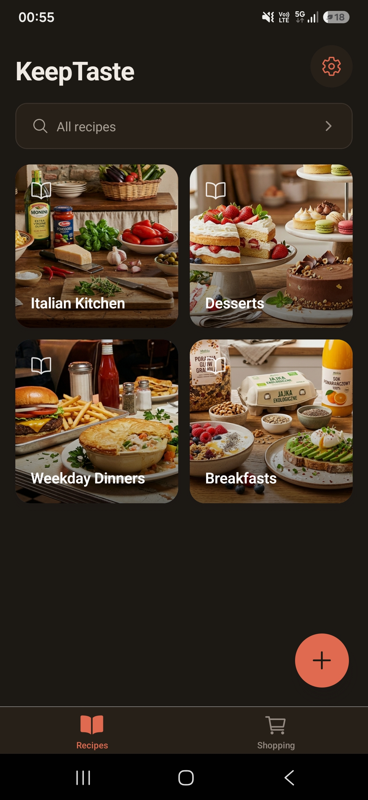
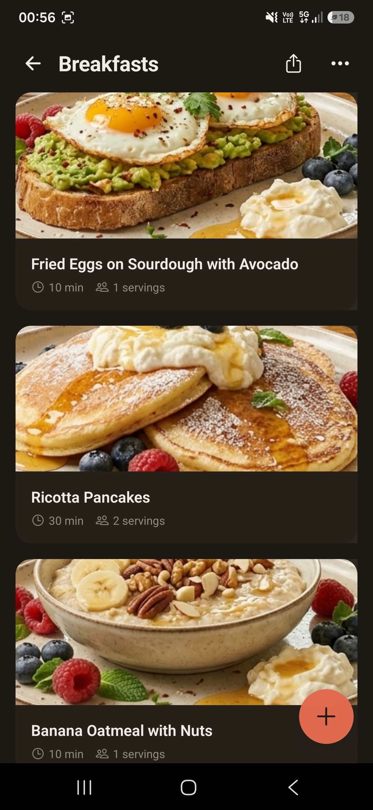
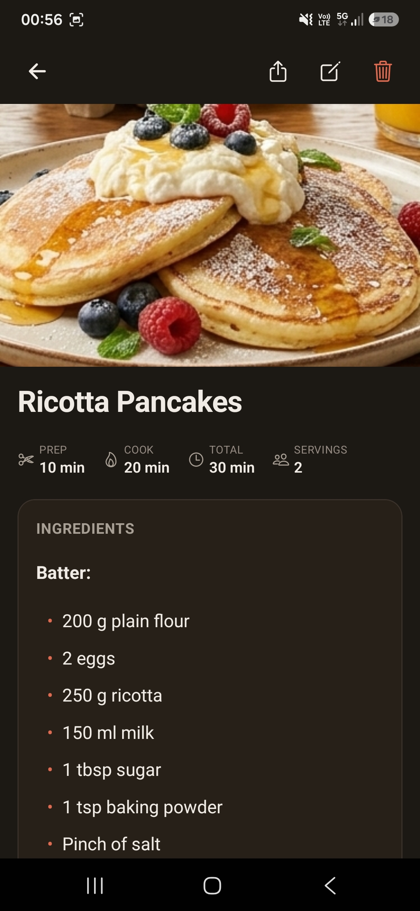
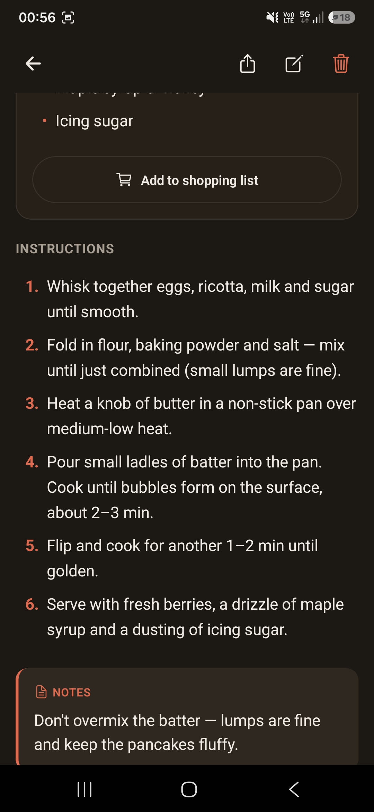
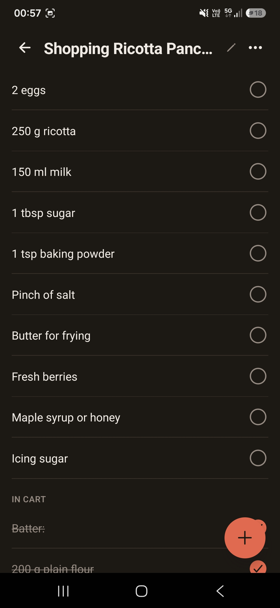

# KeepTaste

> **Your recipes. Your device. No cloud required.**

KeepTaste is a private, offline-first recipe manager for Android. Every recipe,
photo, and shopping list lives in a local database on your phone — there are no
accounts to create, no servers to trust, no subscription, and no ads. Ever.

**Philosophy: your data, your device.** You are never locked in: the whole
library exports to plain, human-readable Markdown, and a complete `.zip` backup
(photos and all) can be restored 1:1 — or mirrored automatically to a
cloud-synced folder *you* control.

<p align="center">
  
  
  
  
  
</p>

<p align="center"><em>Your cookbooks → a cookbook → a recipe → one tap to a shopping list → shopping with the "in cart" flow.</em></p>

## Why KeepTaste?

- **Truly offline.** Works on a plane, in a basement kitchen, on a phone with no
  SIM. There is no network code to fail.
- **Private by design.** No account, no analytics, no tracking. The app never
  talks to a server because there isn't one.
- **No lock-in, guaranteed.** One tap exports everything to Markdown you can
  read in any text editor — and import back later.
- **Fast and focused.** Built for the two moments that matter: saving a recipe
  in seconds, and cooking from it with the screen kept awake.

## Features

### 🍳 Collect & organize
- **Cookbooks with covers** — group recipes the way you think about them.
- **Recipes in Markdown** — ingredients, instructions, and notes with real
  formatting; prep/cook times, servings, and a photo.
- **Import from the web** — paste a link and KeepTaste extracts the recipe
  (Schema.org JSON-LD), or paste plain text and it's parsed into the form.
- **Smart search** — diacritics-safe title search (finds "żurek" when you type
  "zurek").

### 👨‍🍳 Cook
- **Reading-friendly recipe view** with the screen kept awake while you cook.
- **Dark mode** that follows the system.
- **Bilingual UI** — English and Polish, switchable in Settings.

### 🛒 Shop
- **Shopping lists** with an "in cart" flow for the store.
- **One tap from recipe to list** — send a recipe's ingredients straight to a
  shopping list, or paste a block of products.

### 📤 Share
- **Recipe as text** — send it in any messenger.
- **Cookbook as PDF** — a print-ready, localized document.
- **Shopping list as text** — hand the errand to someone else.

### 🔐 Own your data
- **Markdown backup** — the human-readable escape hatch; exports the whole
  library and round-trips through import.
- **Complete `.zip` backup** — everything, including photos, shopping lists,
  and settings; restores 1:1 on a new phone (replace or merge, your choice).
- **Automatic backup** — pick a folder once and KeepTaste quietly keeps a dated
  archive there after every change; point it at a Dropbox/Nextcloud-synced
  folder and your backup is off-device with **zero** accounts in the app.
- **Undo, not regret** — deletes wait behind a 5-second Undo snackbar.

---

## For developers

KeepTaste is React Native + **Expo SDK 52** with **Expo Router 4**, TypeScript
strict mode, and a deliberately boring architecture: no global state manager —
screens load from SQLite on focus and reload after mutations.

See [SPEC.md](SPEC.md) for the full living product spec and
[TESTING.md](TESTING.md) for the manual test plan.

### Tech stack

- **expo-sqlite** + **Drizzle ORM** — local database (manual SQL migrations)
- **react-native-markdown-display** — Markdown rendering
- **expo-image-picker** + **expo-image-manipulator** — photos (downscaled on pick)
- **expo-file-system** / **expo-sharing** / **expo-document-picker** — export & import
- **react-native-zip-archive** + local `safwriter` Expo module — native `.zip`
  packing and streamed SAF writes (no JS-heap ceiling on backup size)
- **expo-print** — cookbook PDF share
- **expo-localization** — system-locale detection for the bilingual UI

### Project structure

```
app/
  _layout.tsx          ← root Stack, DB init, LanguageProvider, auto-backup flush
  (tabs)/              ← bottom tabs: Recipes (index) + Shopping
  settings.tsx         ← language, backups (export/import/auto), delete all data
  cookbook/            ← [id] recipe grid (id="all" = all recipes), new/edit modals
  recipe/              ← [id] view, new/edit forms (shared RecipeForm)
  shopping/            ← [id] list detail ("in cart" flow), new/edit modals

components/
  ui/                  ← base kit: Button, IconButton, Input, headers, Fab,
                         EmptyState, ActionSheet, SwipeableRow, SnackbarProvider
  cookbook/, recipe/   ← shared forms + single-recipe ImportSheet

db/                    ← the only data-access layer (Drizzle over expo-sqlite)
  schema.ts, ddl.ts    ← tables/types + hand-written migration DDL
  client.ts            ← native connection + migrations (client.web.ts: sql.js test client)
  cookbooks.ts, recipes.ts, shoppingLists.ts, settings.ts
  backup.ts, import.ts ← full-backup gather/restore

utils/                 ← pure, unit-tested logic + thin native wrappers
  markdown.ts, backupMarkdown.ts, importMarkdown.ts   ← .md export/import
  backupArchive.ts, backupArchiveFs.ts                ← .zip build/restore
  backupAuto.ts, backupTrigger.ts, backupStatus.ts    ← auto-backup (SAF)
  recipeImport.ts, recipeImportFetch.ts               ← link/paste import
  cookbookPdfHtml.ts, recipeShareText.ts, shoppingListShareText.ts
  search.ts, i18n.ts, numeric.ts, pendingDelete.ts, imageStorage.ts, …

i18n/                  ← dictionary.ts (typed EN+PL), LanguageProvider.tsx
constants/theme.ts     ← design tokens (light/dark palettes, typography, spacing)
```

### Getting started

```bash
npm install
npx expo start        # scan the QR in Expo Go (Android/iOS)
npm run android       # Android emulator / USB device
```

> **Backup flows need a custom dev client** — the `.zip` backup uses native
> modules absent from Expo Go. Build one with
> `eas build --profile development`. Expo Go stays fine for everything else.

### Building an APK / Play bundle

Fully offline debug-signed APK (sideloading only):

```bash
npx expo prebuild -p android
cd android && ./gradlew assembleRelease
# → android/app/build/outputs/apk/release/app-release.apk
```

Local EAS build with the managed signing key (no cloud build quota):

```bash
eas build --platform android --profile preview --local --output ./keeptaste.apk     # APK
eas build --platform android --profile production --local --output ./keeptaste.aab  # Play bundle
```

Requirements for `--local`: `eas-cli`, JDK 17, Android SDK (`ANDROID_HOME`).
Bump `versionCode` before each Play upload; `targetSdkVersion` is set via the
`expo-build-properties` plugin.

### Testing

```bash
npm test             # unit tests (pure logic: db helpers, utils)
npx tsc --noEmit     # strict type check
npm run web          # web build — browser smoke-test environment only
```

Unit tests cover pure logic only; native behavior (Alerts, image picker, file
persistence, share sheet) follows the manual plan in [TESTING.md](TESTING.md).

### Markdown export format

The whole library exports to a single `.md` file (English-only, round-trips
through import):

```markdown
# Cookbook Name

## Recipe Title

**Prep:** 15 min | **Cook:** 45 min | **Servings:** 4

### Ingredients
...

### Instructions
...

### Notes
...
```

The `.zip` backup wraps this same Markdown alongside `backup.json` (full
fidelity: photos, shopping lists, timestamps, settings) and an `images/` folder.

### Database schema

```sql
cookbooks      (id, name, cover_image_path, created_at)
recipes        (id, cookbook_id FK, title, prep_time, cook_time,
                servings, image_path, ingredients, instructions,
                notes, created_at, updated_at)
shopping_lists (id, name, created_at, updated_at)
shopping_items (id, list_id FK CASCADE, name, quantity, checked, created_at)
app_settings   (key, value)
```

Deleting a cookbook sets `cookbook_id` to NULL on its recipes — they survive
under "All recipes". Deleting a shopping list cascades to its items.

### Roadmap

Open items live in [SPEC.md §8](SPEC.md); deliberate out-of-scope decisions in §7.

## License

[MIT](LICENSE)
