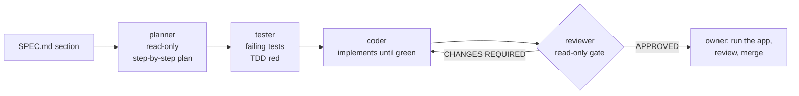

# How this was built with AI

KeepTaste was written with an AI coding agent (Claude Code), from the first
commit on. This page describes how that was kept under control. A
specification decides what gets built. Repository rules decide how. A
four-role agent pipeline builds each feature test-first. Automated checks
and the human owner decide what gets merged.

The short version: **the agent writes most of the code; the spec, the tests
and the owner decide whether it is right.**

## 1. The spec decides what gets built

[SPEC.md](../SPEC.md) is the living product spec. It records the product
decisions (local-only, no accounts, Markdown as the escape hatch), every
feature with its rules, the UI kit, the platform constraints, and an
explicit **out-of-scope list** (§7: cloud sync, ingredient scaling, tags,
…). Features are referenced by section (`§5.15`) in commits, code comments
and tests, so a change can be traced back to the decision behind it.

The spec is updated when a design decision is made, not after the fact.
After the first persona study, for example, the fixes went into the spec
first (`97a1191 docs(spec): fixes from persona testing, iteration 1`) and
into code afterwards (`fb95f64` and the commits after it, same day).

## 2. The repository rules decide how

[CLAUDE.md](../CLAUDE.md) is loaded by the agent in every session. It holds
the rules a new contributor would otherwise learn the hard way:

- **Architecture constraints.** No global state manager. `db/` is the only
  data-access layer. Native file-system calls go through
  `expo-file-system/legacy`. Design tokens are used, never hardcoded.
- **Domain rules.** Deletes wait behind an Undo snackbar. `updated_at`
  changes only on edit-save. Numeric fields are never `NaN`. Search folds
  diacritics in JS, not SQL.
- **Lessons from incidents, written down where they prevent the next one.**
  An unanchored `android/` in `.gitignore` left a local native module out of
  the EAS build archive and white-screened a Play release; the rule and the
  anchored pattern are now in CLAUDE.md and `.gitignore`. A pinned Android
  `targetSdk` went stale until Google Play threatened to block updates; the
  rule now says "do not re-add a pin". A schema change that skips the
  migration ladder breaks only upgrades; that rule is now also enforced by a
  test (§4).

## 3. Four agents per feature, test-first

A feature with real logic goes through four project agents defined in
[`.claude/agents/`](../.claude/agents/), each with its own tools and
instructions:

- **planner**: read-only. Turns one SPEC section into a concrete plan that
  names files, data changes and edge cases.
- **tester**: writes the failing tests first, for pure logic only (no
  component tests; see [TESTING.md](TESTING.md#why-there-are-no-component-tests)).
  It must show the tests fail *for the right reason*: missing behaviour, not
  broken setup.
- **coder**: implements until the tests pass. It is not allowed to weaken
  or delete tests to get there.
- **reviewer**: read-only gate. It checks every plan step was done, runs
  `npm test` and `npx tsc --noEmit`, checks schema/migration consistency,
  and ends with **APPROVED** or **CHANGES REQUIRED** with file-level
  specifics.

Small, low-risk changes (copy, a style fix, a one-liner) skip the pipeline
and are made directly, followed by the tests and the type check.

## 4. Tests and CI are the safety net

The agent's output is never trusted on its own word. Since 2026-11 every
pull request runs, in CI:

- strict type check and ESLint with zero warnings;
- unit tests with a coverage floor measured over *every* file in the logic
  layers;
- integration tests on real SQLite, including an upgrade from every schema
  version that ever shipped. The suite was shown to catch a deliberately
  removed migration step;
- end-to-end tests in the browser, offline by construction;
- secret scanning, a justified dependency-audit gate and CodeQL
  ([SECURITY.md](../SECURITY.md)).

Some bugs only show on a device. CLAUDE.md requires a dev build for the
backup and timer-alarm work, and the owner runs the app before merging UI
changes. [docs/TESTING.md](TESTING.md) lists what is verified where.

## 5. AI on the testing side too

Usability was tested by simulated users: language-model personas that see
only the screen of a real emulator, kept isolated from the spec and the
code. Their verdict is checked against the app's real end state. See
[the persona-lab case study](case-studies/persona-lab.md).

The app itself makes **no AI calls**. "Transcribe with AI" for handwritten
recipes builds a prompt for the user to paste into an assistant of their own
choice and cleans up the answer (`utils/aiTranscribe.ts`). Nothing is sent
anywhere by the app.

## 6. What the history shows, honestly

- **The first 16 commits** (2026-06-10 → 06-20) have messages like `demo`,
  `ux fixes` or `versionCode 4`. From 2026-06-26 (`7110ee1`,
  `feat(backup): …`) commits follow
  [Conventional Commits](https://www.conventionalcommits.org/). The
  exceptions after that are merge commits, a revert, one README edit made
  in the GitHub web UI and two persona-lab history commits.
- **This is a rebuilt history.** Development happened in a private
  repository. For publication its history was rewritten with
  `git filter-repo`: third-party recipe-site text in the OCR test fixtures
  was reworded, and a few internal files were dropped. Up to 2026-11-13
  (`a309360`, `60e2238`), merge commits and one squash commit still say
  "#1 … #15". **Those numbers refer to the private repository's PRs, not to
  this one's.** From 2026-11-19 (`b6a7059`) on, PR numbers are this
  repository's, and they start again at #1.
- **Most commits carry a `Co-Authored-By: Claude` trailer.** That is the
  point of this page, not something to hide.
- **The agent prompts aged.** `.claude/agents/*.md` were written at the
  initial release. They still told the tester there was "no test runner
  yet" and mentioned tag handling after tags had left the MVP, until they
  were refreshed during the publication pass. Instructions to an agent are
  code too and go stale like code.
- **An abandoned experiment.** On 2026-11-18 an end-to-end pilot on the
  `e2e` runner (e2e.com) was committed (`8a01f4a`). It targeted both the web
  build and a release APK on an emulator, with room for model-driven
  steps. It was left incomplete: its config pointed at a `docs/e2e.md` and
  an `npm run e2e:android` script that never existed. The publication audit
  caught the dangling references; nothing automated did. It was replaced by
  deterministic Playwright tests on the web export as the CI gate, with the
  same flows ported. The Android side was added later as a separate,
  local-only Maestro suite (`.maestro/`, [ADR 0011](adr/0011-maestro-android-e2e.md)).

## Reuse

The same planner → tester → coder → reviewer cycle is packaged as a
generic Claude Code plugin,
[ai-starter](https://github.com/Maleckidd/ai-starter), with per-feature
model routing and a template for new apps.
